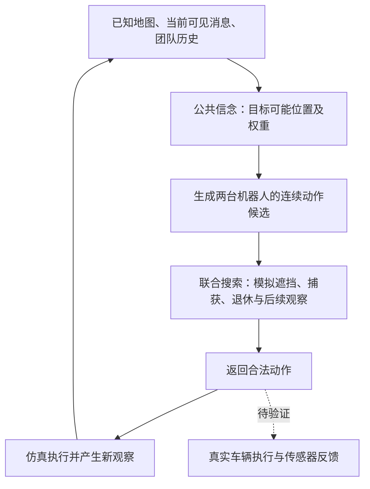

# 面向 IROS 2027 的研究成果盘点与论文审查

首次审查：2026-11-05；更新：2026-11-07，Asia/Shanghai。文件名保留原日期以维持引用。

**编号与论文证据口径（2026-11-07）：正式实验截至E47。** 此后四批追逃轨迹材料仅供看图，原临时编号E48/E49/E50/E51已撤销，不计入正式实验、论文主表或新增研究成果。[可视化演示归档](../current/trajectory_visualizations_20261107/README.md)保留图片和原始记录，不能用这些演示修改下述正式研究判断。

目标保持不变：形成一篇有明确机器人研究贡献、证据可靠、能够投稿 **IROS 2027** 的论文。

本报告从写论文的角度审阅[实验总记录](Git提交后实验完整汇总_20261025.md)，结合关键结果、当前实现及一手相关工作。它不是另一份按编号抄写的流水账，也没有重新训练或逐局重审全部历史数据。实验事实、对事实的解释、尚待验证的贡献分别表述。旧方案中的“下一步”不自动视为已完成。

**11-07最新结论：E47 L5同池确认16,224局和延迟验证672局已于14:49:06完成。** 两项预定主要比较确认L5搜索相对自身直控的原始效用收益，未确认学习排序优于同池几何搜索；超长尾定位到公开观察/信念更新层，仍未解决硬实时。额外学习逃逸对手和实车未执行。详见4.8及第九节。

**11-06阶段结论（历史）：E46已完成75个训练作业和22,464局独立封存评测。** 新的候选池学习排序在有限模拟预算下表现很好，200 ms下也有平均收益；两个新方案在OOD、200 ms下相对GEOM的主要效用同时区间为正。相对旧PRIOR/混合的优势、同池排序的独立归因仍未确认；100 ms存在69.1秒单步长尾，硬实时性尚未成立。具体见4.7，后续优先级见第九节。

## 一、先用简单的话说明我们现在走到了哪里

**我们已经做出了一套能够完成指定遮挡追逃任务的仿真研究系统，完成了真实的网络训练、较丰富的比较和机制诊断，也得到了明确的强化学习增益。现在的主要问题，是把这些工作凝结成一个与已有工作有清楚区别、对机器人有实际意义的主贡献，并补齐对应证据。**

我认为，下面四句话可以同时成立：

1. **我们已经积累了实质成果。** 不只是搭环境、调参数或写计划；已有训练完成的模型、新地图闭环结果、组件作用证据和可复算的结果档案。
2. **已有材料足以开始写一份严谨的论文初稿。** 问题定义、系统方法、实验协议、主结果和相当一部分消融已经有内容，不必继续等“所有强化学习方法都很强”。
3. **最核心的方法贡献已有新线索，尚未完全站稳。** E46候选排序取得有限模拟收益及OOD/200 ms相对旧GEOM的局部统计确认；11-07同池独立比较已完成，确认搜索相对自身直控的收益，未确认学习排序相对同池几何的独立优势。现有结果仍需凝结成与已有神经树搜索有清楚区别的主张。
4. **真实车辆上的最新方法闭环尚未完成证据链。** 迁移方案、硬件调查、三维仿真准备有价值，但不能写成这套局部观测双车方法已经完成实车实验。

因此，不宜说“我们还是什么都没做成”，也不宜说“只要补一段实车视频就够投了”。当前最准确的定位是：**研究资产和实验基础较完整，已经能写；投稿主张还要收紧，关键贡献与机器人验证需要对齐。** 这是研究判断，不是录用概率估计。

## 二、从机器人问题看，我们究竟在研究什么

### 2.1 可以形成论文的问题主线

两台机器人在有障碍的环境中追捕两个目标。它们会丢失目标视野，需要结合历史判断目标可能在哪里；还要同时决定两台机器人的连续运动。抓住第一个目标后，参与捕获的机器人也退出后续任务，团队的行动和新增观测能力发生变化，剩余机器人必须在时限内完成第二次捕获。

这包含三个有实际意义的困难：

- **信息不完整：** 看不到目标时，最近一次看见的位置不能直接当成当前位置；多个绕障分支可能同时合理。
- **团队任务持续变化：** 第一次捕获不是任务结束，剩余目标、可用机器人和未来观察条件都会改变。
- **计算时间有限：** 决策不能无限搜索，必须把估计、生成动作、模拟与合法返回的时间一起考虑。

“局部观测”在这里指目标信息受视线与距离限制；队内共享公共消息与历史。它不等于每台机器人只能独立读取自己的传感器，也不等于不需要通信或共同坐标。

### 2.2 哪些设定必须有真实动机

**捕获后为什么追捕机器人也退出？** 仿真中它是明确规则。论文需要对应实际任务，例如确实需要占用机器人进行看守或处置；如果实际应用没有这个约束，就不能仅为研究故事而宣称它是机器人追捕的普遍规律。改变实车任务时，应明确建立新版本，保留原仿真结果的适用范围。

**为什么不显式分配目标？** 这是当前研究选择，不是“目标隐藏所以任何分配都不可能”。我们自己的强几何方法已经说明，带目标选择或匹配的方法可以很有效。合理做法是解释希望减少哪种人工决策结构、在什么场景有价值，同时完整保留这些强参考；不能只把它们移出主表就认为问题解决。

**为什么需要学习？** 不能只回答“神经网络更先进”。需要说明它带来更好的候选、更少的有效计算、更好的适应能力，或其他明确收益；现有结果只支持其中一部分。

这些动机成立与否，比增加一个新网络模块更影响论文说服力。

## 三、我们已经完成的工作，按成果类型重新归类

|成果类型|实际已经完成什么|论文中的价值|目前边界|
|---|---|---|---|
|任务与仿真平台|遮挡、障碍、公开历史、连续动作、双捕、捕获退休、有限时限，以及不同地图和固定对手的统一运行|提供可重复的机器人决策问题和实验协议|主要仍是简化平移动力学、理想化传感器；不是实车物理的完整复制|
|目标状态估计|带权、多分支的目标位置表示，利用看见和没看见的信息，合法可达支持与细化恢复|形成独立可复用的估计模块，有离线确认数据|不是已证明准确的连续贝叶斯后验，也没有完整闭环归因|
|学习与规划系统|连续动作网络、联合搜索、E46候选排序，以及11-07同池独立确认|有限模拟与旧GEOM比较的局部证据；新同池确认支持搜索相对自身直控|学习排序相对同池几何优势未确认；不能把继承的神经树搜索算新发明|
|规模与结构实验|实际完成多种网络、多个种子、经验规模、价值开关和相关采样比较|给出了哪些组件值得保留、哪些原假设不成立的证据|训练次数、检查点和实验编号不等于独立算法或独立样本数量|
|学习型控制对照|作者训练链校准、任务适配、监督初始化后强化学习、冻结起点和随机初始化对照|已经能检验真正的强化学习增益，不只比较几个低分控制器|当前有效路线是集中式团队控制；陌生布局仍明显下降|
|统计与复现工具|验证选模、测试冻结、地图分组、同时区间、模型与源文件哈希、失败留档、恢复预算|使论文结果更可信，也便于形成补充材料与复现实验包|这些是可信研究基础，不自动构成新的机器人算法|
|部署准备|车辆接口、坐标、底盘、计算设备和迁移分析；独立三维仿真传感器/教师链路|降低后续实车验证的工程风险|尚未找到最新公共信念双车规划器接入真实车辆的闭环对照|

平台、方法、科学发现和工程能力都是成果，但它们在论文中承担的角色不同。不能把所有工作压成“我们提出了一个新算法”，也不应把有价值的平台与验证工作全部忽略。

## 四、已经得到哪些有依据的科学结果

### 4.1 全状态阶段：找到了旧系统真正有用和无用的因素

早期同配置确认中，关闭旧价值网络将成功率从74.67%提高到85.00%。首捕后的匹配干预还表明，动作幅度会明显影响完成能力；不能把某些提升全部解释为预测拦截更聪明。另一方面，简单全状态后段的几何控制很强，没有检出保留大量树搜索的额外成功率收益。

这部分工作的价值是**排除了不正确的收益解释，识别了算法复杂度可能不值得投入的任务阶段**。它不等于提出了普遍更优的新价值学习方法，也不能把这些全状态场景的提升直接算到后来的局部观测方法上。

来源：[总记录第一节及早期阶段](Git提交后实验完整汇总_20261025.md#一到目前为止已经得到什么)。

### 4.2 估计阶段：我们已有一个可独立验证的研究资产

多模态估计器的确认记录包括96/96接管检查通过、隐藏状态覆盖83.22%，以及在指定范围和匹配均匀对照下，负对数似然差约−0.448，同时区间为［−0.790，−0.106］。

这支持：**在那轮条件下，估计表示包含了比匹配均匀近似更有用的位置分布信息。** 但覆盖不等于概率校准；估计指标改善也不直接证明完整团队任务的捕获收益。

我认为这项资产值得重新认真审查其方法边界。它可能比继续寻找一个陌生强化学习算法名更接近我们的实际技术积累。不过，**研究资产不等于新颖性已经证明**；还要和合理的可见性条件粒子估计、可达支持等方法比较，并补足闭环作用。

来源：[总记录的估计器结果及E35阶段](Git提交后实验完整汇总_20261025.md)。

### 4.3 经验规模阶段：学习确实能改善完整规划系统

经验规模实验中，在同样200ms条件下，完整联合模型面对真实搜索对手的双捕率，从低经验档62.5%提高到高经验档85.6%；相应预定效用比较的同时区间为正。

这不是“训练始终没有帮助”。它说明**这套任务中至少存在可被学习利用的技能和数据瓶颈**。但地图覆盖、经验量和更新量同时增加，不能把改善归因于其中唯一一项，也不能写成只增加GPU就会提升。

来源：[经验规模实验及统计](../current/e45c_budget_scaling_20261028/ANALYSIS_AND_NEXT_STEPS_20261028.md)。

### 4.4 当前学习搜索：有真实收益，但必要性要分层讨论

已有独立新图比较确认了学习提议加搜索相对相应直控和无网络树的部分收益；多轮记录也支持保留简洁的单峰提议、关闭部署学习叶价值。

这里的“单峰”不是只控制一台机器人。当前动作仍是两车的联合动作，仍使用团队公共信息和联合搜索。反过来，网络一次输出两台车的动作，也不自动证明学到了不可替代的联合相关结构。

W阶段同模拟数实验中，面对Root对手、相似类型新地图、固定16次完整模拟时，学习提议双捕91.67%，几何提议66.67%；原始效用差约+0.2703，同时区间［0.0713，0.4693］。这是一个值得在论文中保留的正结果。

W阶段同时间实验中，相对强几何的效用区间全部包含零。例如200ms、Root对手下：

|测试范围|学习提议搜索|强几何搜索|
|---|---:|---:|
|相似类型新地图|93.52%|97.22%|
|陌生布局新地图|95.14%|97.92%|

不能说几何已被证明一定更好，也不能说学习已经稳定领先。截至W阶段的证据更支持：**学习提议在一个预定的低模拟条件有帮助，但稳定的实际计算收益仍没有充分建立。** E46新增候选排序及OOD/200 ms的局部确认见4.7，不能继续把W阶段判断当作所有后续实验都没有同时间正结果。

来源：[六项实验最终审查](../W六项实验最终结论与论文路径_20261105.md)、[同时间结果](../current/e45w_joint_ppo_and_planning_20261103/planning_wall_repair1/summary.json)、[同模拟数结果](../current/e45w_joint_ppo_and_planning_20261103/planning_sim_v2/summary.json)。

### 4.5 强化学习阶段：终于分清继承能力和后续学习增益

最新统一测试，使用验证集选中的模型，三个种子平均：

|控制方式|相似类型新地图|陌生布局|整体|
|---|---:|---:|---:|
|已有网络直接使用，不再训练|37.27%|26.74%|31.25%|
|相同结构，从零做强化学习|3.24%|3.65%|3.47%|
|已有网络打底，再做强化学习|88.89%|46.01%|64.38%|

已有网络继续学习，相对原起点整体增加33.13个百分点。原始效用差约+0.371，按地图分组的描述区间为［0.294，0.446］，三个种子都改善。这支持**强化学习阶段确实带来了新能力，而不仅是继承了监督训练的成绩**。

局限也明确：陌生布局下降很大，在陌生布局、Root对手下只约34.72%。所以现在已经有有效且在相似新图上有竞争力的学习对照，但还没有得到全面强泛化的学习控制器。区间固定当前三个训练种子，不能当作训练种子总体的不确定性。

该控制器准确名称是“监督初始化的集中式团队PPO”。两个机器人联合输出动作，部署共享公共信息；不能冒称去中心化MARL或作者RMAPPO复现。监督数据和教师成本也必须记录。

来源：[统一最终测试](../current/e45w_joint_ppo_and_planning_20261103/final_evaluation_repair1/REPORT.md)、[地图分组比较](../current/e45w_joint_ppo_and_planning_20261103/final_evaluation_repair1/paired_group_statistics.json)。

### 4.6 失败诊断：已经获得有用边界，不必继续无限修补

|诊断路线|实际回答了什么|没有回答什么|
|---|---|---|
|教师示范、模仿与纠错|仅加入成功经验或把原标签拟合得很准，不保证真实闭环成功；少数相反标签能由搜索预算差异复现|没有证明所有模仿学习无效，也没有证明标签冲突是全部失败根因|
|退化与价值核验|已学技能可能退化，价值估计明显失准；只降价值网络学习率没有稳定保住能力|不能确定唯一因果链，不能证明整个离策略算法不适合追逃|
|完整作者训练链校准|作者完整流程在原生连续任务能稳定学到|不等于追逃适配自然成功|
|全状态追逃|当前适配即使给必要真值仍弱，不能只归咎遮挡|不等于该任务不可学习；有效控制器和后续学习路线已经存在|
|首捕后剩余价值、计算分配、对手预测三条候选|完成了有限预算检验，当前实现没有足够稳定的独立增益；预测失配存在但旧收益未在新批复现|不能宣称已经找到新的成功方法，也不能宣判整个研究方向无效|

这使我们有依据停止某些支线，把资源转向论文核心。**科学上排除一个不成立的解释有价值；论文中却不宜把每次排障都写成一项独立贡献。**

来源：[原生校准完成](../官方HASAC校准完成与全观测迁移判断_20261103.md)、[全状态诊断](../HASAC全状态失败原因核验与下一步决策_20261103.md)、[创新候选最终进展](../IROS2027方法创新可行性进展_20261104.md)。

### 4.7 E46：候选排序取得局部确认，同时暴露实时性缺口（11-06更新）

> 以下保留E46当时的证据与缺口；后续同池确认、长尾定位与执行验证见4.8，不将本节的“尚未执行”当作最新状态。

**E46于2026-11-06 18:58:52完成。** 新训练/验证/开发/封存地图240/24/48/72张，75个训练作业，22,464局封存评测，无失败任务。部署基于公共历史信念和两车联合搜索，关闭学习叶价值；开发阶段冻结两个新方案和混合比例后才执行封存评测。以下结果与W分别报告，不用跨批胜率变化作为因果证据。

L5基础版在16个几何/随机完整联合候选上学习评分顺序。L5_r2_repeat先继承第一轮混入学生状态纠错数据的r1_aggregate模型，第二轮再只用旧数据训练10 epoch；不能把它说成从头到尾只重复旧数据。第二轮repeat与aggregate共享同一起点，用于比较当前轮是否混入纠错数据；该模型入选本身不证明纠错贡献。

|方法|16次完整模拟双捕率|100 ms双捕率|200 ms双捕率|200 ms原始效用|200 ms完成成本（步）|
|---|---:|---:|---:|---:|---:|
|GEOM|81.94%|44.10%|93.06%|0.8506|31.99|
|PRIOR|90.62%|49.88%|95.83%|0.8821|30.49|
|MIX0.75|92.82%|48.15%|95.72%|0.8827|29.80|
|L5_base|96.30%|49.31%|97.69%|0.9167|24.06|
|L5_r2_repeat|95.72%|49.54%|97.92%|0.9187|24.18|

汇总先在同图内对世界/种子取均值，再按地图等权；上表进一步对ID/OOD及两类对手等权。完成成本失败计剩余时域。16模拟的L5基础版比GEOM/PRIOR高14.35/5.67个百分点，支持有限模拟效率的描述性改善；200 ms相对PRIOR的平均完成成本减少约21.1%。不能将固定模拟数优势直接换算成计算加速倍数。

预设24项主要比较按地图成组bootstrap并做全家族同时95%区间，只有以下两项完全高于零；检验指标是原始效用，不是双捕率。

|方案相对GEOM|范围|预算|原始效用差|全家族同时95%区间|
|---|---|---:|---:|---|
|L5_r2_repeat|OOD|200 ms|+0.08996|[+0.01588, +0.16404]|
|L5_base|OOD|200 ms|+0.10062|[+0.02654, +0.17470]|

这使“学习规划从未在同时间优于几何”成为过时概括；准确更新为**在OOD、200 ms下有局部确认，尚未确认全面或稳定优于旧网络**。全部相对PRIOR、MIX0.75的主要区间覆盖零，不能宣称显著优越，也不能将不显著当成等效。三枚训练种子固定，不构成训练种子总体区间。

**学习作用还有一个关键归因边界。** 开发集中，同池均匀/简单几何/学习排序在200 ms的双捕为90.10%/96.35%/98.09%；在16模拟则为83.85%/97.92%/95.31%，简单几何反而更好。同池控制未进入最终封存，L5相对旧GEOM/PRIOR同时改变了候选池和排序，不能把全部收益都归给学习。这是贡献证据的具体缺口，而不是再加一种算法名就能解决的问题。

其余机制结论也应收紧：旧Joint在模型内短期教师参考中较弱，GEOM教师与旧PRIOR接近；复杂Joint8生成式学生未显示稳定必要性；混合比例开发优化收益小；L5基础/旧数据重复/新增学生状态纠错的开发分数0.65332/0.65350/0.64607，未显示新增纠错数据的稳定额外收益。这些是开发诊断，不冒充全部通过封存确认。

**实时性是明确的部署限制。** 全部11,232局固定时间封存trace复算显示，L5基础100 ms下58.35%的决策零完整模拟，最大act为5.53秒；续训版有一次69.1秒单步，CPU用时也约69.1秒、0完整模拟并返回停车。零模拟不只是对手强弱的任务失败信号，还涉及信念/特征/模型准备、预算中止与停车。具体极端耗时子函数仍需定位。200 ms基础版零模拟约0.13%、完整act合并P95为197.24 ms、超时约0.23%、最大288.85 ms，仍不满足每步200 ms硬截止。

因此，E46支持把候选排序作为后续实现和贡献核查的重点，但不能写成已解决严格实时部署。锁步仿真没有把额外计算时间转为对手继续运动，不能直接将这些双捕率当作实车按时执行结果。E46也不能替换原SGPD全状态稿的85.7%主表，或为其中学习叶价值的贡献背书。

来源：[E46完整分析](../E46结果分析_20261106.md)、[总记录4.51](Git提交后实验完整汇总_20261025.md#e46-main)、[协议](../code/E46_GEOMETRY_TEACHER_PROTOCOL_20261105.md)、[最终原表](../current/e46_geometry_teacher_20261105/final/REPORT.md)、[完整结果和主要区间](../current/e46_geometry_teacher_20261105/final/results.json)、[逐决策耗时复算](../current/e46_geometry_teacher_20261105/postrun_timing_20261106.json)。

### 4.8 E47：L5同池归因与执行验证——搜索增益确认，学习排序优势未确认（11-07更新）

本轮正式编号统一为 **E47**，原内部运行标识及目录作为历史数据身份保留，与E46分别记账。

**本轮于2026-11-07 14:49:06结束：312张新图（ID/OOD各156）、16,224局正式200 ms确认，另有24图672局延迟验证；无新增训练。** 复用E46 L5基础版三个冻结种子，先在48张已查看开发图上完成固定16模拟和200 ms预跑各2,496局，再按开发方差一次冻结样本量。没有根据正式结果增样或重新挑选种子。

A1—A5共用既有最多16候选、75%几何/25%随机的规则；固定公共根直接注入同一候选数组，闭环分化后只保证同一生成规则。R1/R2保留旧GEOM和Single PRIOR，合计7种方法、13实例。观察、信念、退休、几何势和Value-Off口径一致；直控不填满200 ms。

|代号与方法|ID双捕率|OOD双捕率|ID完成成本|OOD完成成本|
|---|---:|---:|---:|---:|
|A1 同池均匀顺序＋搜索|94.55%|91.35%|32.71|32.16|
|A2 同池几何排序＋搜索|97.60%|97.60%|27.02|22.90|
|A3 L5学习排序＋搜索|97.54%|97.33%|26.37|21.05|
|A4 同池几何最高分直控|96.47%|97.60%|27.76|22.21|
|A5 L5最高分直控|87.93%|95.14%|32.89|24.23|
|R1 旧GEOM搜索|94.87%|90.87%|32.35|30.23|
|R2 旧Single PRIOR搜索|95.14%|95.30%|32.19|29.66|

|预定主要比较|整体原始效用差|同时95%区间|解释|
|---|---:|---|---|
|A3−A2：L5搜索−同池几何搜索|+0.001530|[−0.011953, +0.015014]|未确认学习排序优于同池几何排序|
|A3−A5：L5搜索−自身最高分直控|+0.071151|[+0.057667, +0.084634]|确认搜索相对自身直控的效用增益|

主要比较在地图内平均世界、对手和固定模型，再对ID/OOD等权；312图分层bootstrap10,000次，对两项整体原始效用差控制同时区间。双捕率和子集成本是描述指标，不能替代效用检验。**搜索相对L5直接执行最高分候选有确认收益；学习排序相对同池几何搜索的优势未确认。** 后者区间跨零不等于等效；其上端也小于本次设计的效用差0.02，不支持把≥0.02作为整体增益。不能继续将“缺少同池封存对照”列为未执行，也不能把已经检验但未确认写成只差多跑几个样本。

**执行和机制诊断也已完成。** 256个固定公共根、3,840搜索＋1,024直控决策表明，固定16模拟的平均实际最大深度约1.8、最高3；深度配置8不能直接写成已完成8步深层对抗。128根的有限扩展参考与12,192局后验首动作干预均有原始记录，但受有限候选、模型和统一延续策略限制，不是额外12,192张真实地图确认。完整记账见总账4.52。

**异常长尾收窄到`observe`公开观察/信念更新层，未完成硬实时修复。** 原69.1秒现场在三次公开前缀重放中仍耗85.6—89.8秒，几乎全部属于`observe`，CPU与墙钟同量级，均零模拟；另外两类异常同样定位到该层。重放未精确复原原缓存和墙钟相关随机状态，不能把重放秒数当原现场逐位复现，也不能把层级归因夸大成内部唯一子过程已经修复。

延迟包按1 s控制/传感周期、200 ms截止与独立执行端停车/丢弃晚到结果模拟：L5搜索零/实测延迟双捕100%/97.22%，效用0.94292/0.90518，成本22.83/26.82步；同池几何搜索双捕两者均97.92%。A3实测模式8/3,886次决策超截止。仅24图的描述性执行诊断，不能证明延迟普遍有益/无影响、求解器已能硬中断或已完成实车验证。

**对手能力也要诚实命名。** 固定D核不是按当前追捕位置优化的逃跑策略；RootPUCT3000虽读取全状态，但关闭策略/价值网络、依靠随机后续推演。计算预算大不自动等于高水平逃逸或最坏情形。45局可视化展示了包括AG/IG、RouteAPF、PPO等参考的轨迹，但不是新增正式统计；三张演示图的追捕/逃跑每轴速度上限为1.3/1.0。不能凭高双捕率直接证明普遍对抗能力。

额外Search＋Learning对手因264/270维接口不兼容未执行；最新实车验证因前置缺失未执行。此前运行中的只读缓冲修订、调度停机与32路计时扩容有完整记录，不作为科学方法创新或新的独立样本。64/80路未过固定工作校准，正式计时保留32路。

这轮结果进一步支持**现在用已有系统认真写论文，同时把学习排序的贡献主张收紧**。不需要因此推翻系统或提出新方法，也不能删去同池几何/直控的强结果来维持原有故事。E46的局部正结果与本轮同池未确认同时成立，来源和比较对象不同。

来源：[总账4.52](Git提交后实验完整汇总_20261025.md#l5-followup-20261107) · [正式报告](../current/l5_followup_20261107/final/REPORT.md) · [原始结果和区间](../current/l5_followup_20261107/final/results.json) · [完成状态](../current/l5_followup_20261107/progress.json) · [逐阶段复算](../current/l5_followup_20261107/documentation_update_20261107/verified_summary.json) · [已迁移实施记录](../current/l5_followup_20261107/docs/L5同池归因与执行验证实施记录_20261107.md) · [轨迹图册说明](../current/pursuit_evasion_figures_20261107/README.md)。

## 五、微观上，当前主方法到底是什么

可以用下面的链路解释当前仿真系统：

图里的模块并非都已证明原创，也不表示实车分支已经完成。

从论文可核查性看，至少需要把以下事实写准：

|要素|当前实际含义|容易写错的说法|
|---|---|---|
|公共信息|已知地图、队内共享的可见报告和历史，目标隐藏时用信念估计|把仿真中的真实目标坐标当作部署输入，或声称完全无通信|
|信念模型|有限支持与近似运动模式；可利用否定观察并细化恢复|声称连续后验完备、已校准、永远不会丢失合法支持|
|连续联合动作与候选排序|两台车一起选动作；E46 L5学习有限完整联合候选的扩展顺序，再进行联合搜索|把单峰写成单机器人，或把有限池排序冒称全连续最优、相关性收益已证实|
|叶节点评价|当前表现较好的搜索关闭学习叶价值，仍使用几何势等结构|把论文写成“学到的价值成功指导长时域规划”|
|规划长度|有深度上限，且新叶会提前停止；近期诊断实际深度较浅|把80步完整任务完成写成单次搜索已精确预见80步|
|对抗性|主要使用两类固定对手，包括高计算量搜索对手|声称已找到博弈均衡、已验证最坏情形或双方持续自博弈|
|运动与安全|已在指定简化模型内检查合法位移和捕获规则|直接声称动力学真实、实车无碰撞保证或任意平台可部署|
|计算代价|规划完整返回与启动历史分列，嵌套分项不能直接相加|只报网络推理，或把多CPU训练吞吐当作单车决策提速|

E46进一步确认低预算时延是实质缺口：100 ms下L5基础零完整模拟58.35%，续训版有69.1秒单步；200 ms基础完整act P95为197.24 ms，仍有约0.23%超时、最大288.85 ms。不能只报网络推理或P95来支持硬实时。11-07已在公开前缀重放中把异常耗时收窄到`observe`信念更新层，并完成672局事件时间延迟验证；内部子过程、稳定截止和车载闭环仍未解决。桌面服务器数值不能直接作为车载计算机性能。E46来源见4.7；W历史来源保留如下。来源：[成本结果](../current/e45w_joint_ppo_and_planning_20261103/planning_wall_repair1/summary.json)、[平台现场分析](../mcts_platform_migration_analysis.md)。

## 六、把“自己做出来了”与“相对已有工作的创新”分开

### 6.1 已核对的相关工作边界

|相关工作|它已经覆盖什么|对我们论文的直接约束|
|---|---|---|
|[原始NTE，2021](https://arxiv.org/abs/2104.09705)|神经网络引导连续动作树搜索、部分信息的分散式学习规划器、专家示范与实机展示|不能把“部分观测＋连续动作＋网络＋树”本身称为首次提出；也不能把原NTE笼统写成只有完全信息|
|[连续空间POMDP在线算法](https://arxiv.org/abs/1709.06196)|加权粒子信念与连续空间在线搜索，并分析树内信念退化问题|“带权粒子＋搜索”不是足够的新颖性描述；需要具体解释我们的支持、观察处理或任务结构有何不同|
|[Belief Embedding Tree Search，2026预印本](https://arxiv.org/abs/2610.15046)|在搜索中使用可传播、可采样的学习信念表示，并联合训练相关网络|给信念加网络、再接策略和值，不能自动视为新方向；这里只核对概念边界，不把预印本冒称已通过会议评审|
|[R2PS，ICLR 2026论文](https://openreview.net/pdf?id=zqA7Q9Q21L)|图上部分可观测追逃、信念处理与跨图策略学习|追逃中使用信念与学习已有先例；其图上动作和理论条件与我们连续两车任务不同，不能直接照搬其保证|

这是定向一手文献核对，不是穷尽式新颖性检索，也不意味着这些方法都能不作适配就成为我们的实验臂。

尤其要纠正一个可能影响论文写法的问题：**我们不能把自己的工作概括为“原NTE是全观测，我们第一次把它改成局部观测”。原论文已经明确讨论部分信息。** 真正需要核对的是持续隐藏目标的信念、多个观察者的否定信息、捕获退休后的团队状态，以及这些内容如何进入有限预算的连续联合规划。

### 6.2 哪些内容可能成为我们的贡献，哪些目前还只是候选

**已经完成、但不宜单独当核心新颖性：** 更换框架、增加CPU/GPU并行、保存恢复、修复只读数组或数值误差、接入既有强化学习方法、把几个标准模块串起来。它们是重要工作，但需要服务于新的机器人问题和可验证技术主张。

**值得认真整理的方法资产：** 面向遮挡历史的几何一致信念表示、团队观察条件更新、动作与信息资源同时减少的任务接口，以及学习提议、有限候选池排序和联合规划的具体衔接。它们已经有实现和部分证据，但还需要逐条说明“哪些继承、哪些新增、为什么新增处理必要”。

**尚未建立的主张：** 联合相关分布不可替代、学习叶值改善决策、联合树稳定优于匹配分解控制、当前信念模块给最终任务带来独立增益、学习排序相对同池几何控制的独立优势（11-07已检验但未确认）、跨范围稳定同耗时胜过强几何或旧网络、严格实时、最新方法已经实车验证。E46的OOD/200 ms局部确认不再列为“尚未取得”，但不能扩展为这些更强主张。

我不认为现在必须推翻整个系统，重新发明一个完全陌生算法。**应先把已有具体技术差异形式化，检验其中最有希望的一条能否成为完整贡献；若差异只是常规适配，就不能靠换名字提升新颖性。**

## 七、从 IROS 目标看，目前最关键的缺口是什么

### 7.1 不是缺少更多实验编号，而是缺少足够清楚的主张

当前已经做过很多工作，但它们围绕不同问题：有的改善估计，有的改善提议，有的排查训练，有的只验收工程。论文需要回答一个集中的问题，而不是证明“我们尝试过很多方法”。

我建议用一句研究问题约束后续工作：

> 在持续遮挡、捕获后可用机器人减少、在线计算有限的情况下，怎样利用公共信念和连续联合规划，获得有证据支持的团队追捕收益？

这是一句问题定义，不是已经证实的创新宣言。接下来需要明确当前方案解决其中哪一段、通过什么不同于已有方法的处理解决。

### 7.2 学习规划相对强几何的价值仍需具体化

没有必要要求一个方法在每个格子都第一。可以有价值的增量也可能出现在特定预算、信息条件、传感误差或部署资源下。但必须预先说明这一轴为什么对机器人重要，并在相同条件下验证。

E46的有限模拟表现与OOD/200 ms相对旧GEOM局部确认保留。11-07已经完成同池几何/均匀及自身直控的新图比较：搜索相对L5直控获确认，学习排序相对同池几何未获确认，不能继续将它当成尚未补的空白。若以学习排序作为核心贡献，就必须正面解释这项结果；完整链路的稳定截止仍未成立。人为排除目标分配、只留低分学习对照、只挑成功地图，都不能补齐缺口。强几何参考应完整呈现并解释成本与适用条件。

### 7.3 估计模块与联合规划的独立作用尚未闭合

估计指标改善、整套方法高成功率，并不能自动证明估计模块是高成功率的原因；所有方法共用同一估计时，方法间比较也无法回答这个问题。

如果论文把公共信念机制作为主贡献，应选择合理的替代估计表示，在固定控制器、观察条件和预算下检查任务收益，而非只比明显不适合的点均值或弱均匀分布。还要看收益是否只对神经提议有效，还是也让几何方法受益。后一种情况同样可能有研究价值，只是论文应将贡献归给信念机制。

如果论文强调两车联合规划，则需要与同信息、同总预算、合理协调接口的分解控制比较。当前“网络同时输出两车动作”不足以替代这一证据。**这两类归因缺口不必同时展开；应按最终主张择其关键者。**

### 7.4 真实机器人证据尚未连接到当前主方法

已有硬件与迁移分析有用；独立三维仿真也跑通过传感器和教师完整比赛。但那是另一套5v5仿真链路，不能算最新局部观测2v2方法的验证。

对本项目，实车最有价值的验证不是“车会动”，而是：

- 遮挡后依靠允许的信息重新找到目标，而非使用评估真值控制。
- 如果捕获退休确有实际任务依据，退场事件和剩余任务能在同一系统中正确延续。
- 坐标、目标跟踪、通信与时延进入闭环后，主要收益和失败模式仍可复现。
- 在相同实车条件下，与强几何对照比较，而非只播放单方法成功片段。

IROS的官方编辑说明不允许仅因缺少真实实验或仅有增量贡献就不经评审直接拒稿；这不等于这些论文必然被接收。**所以“没有实车一定不够”和“加了实车一定够”都不是合理规则。** 对我们而言，实车的高价值来自检验尚未验证的信息与时延假设。[IEEE RAS官方说明](https://www.ieee-ras.org/conferences-workshops/financially-co-sponsored/iros/information-for-iros-associate-editors/)

## 八、已有材料怎样组织成一篇论文

### 8.1 建议的工作主线

可以暂以“**遮挡与捕获退场约束下的公共信念连续协同追逃**”作为工作标题方向。标题描述研究对象，不提前承诺最优、首次、严格实时或全面优于几何。

正文围绕一条链条组织：

**实际机器人问题 → 现有处理的具体不足 → 我们新增的处理 → 为什么会改善决策 → 有针对性的比较 → 实际部署能否保留这种改善。**

方法名称、实验规模和算法名都应服从这条链条。

### 8.2 当前能写、需要条件才能写、暂不能写的贡献

|候选贡献|当前可写内容|还缺什么|
|---|---|---|
|公共信念与团队决策系统|明确问题、观察接口、连续动作、捕获退休和可复现实验系统|与已有方法的精确差异、真实任务动机及关键机制作用|
|学习提议与候选排序|保留E46局部正结果；11-07独立确认搜索相对自身直控的效用收益|同池学习优势已检验但未确认，硬实时未建立；不能把候选池与学习效果混为一项|
|学习控制实证|监督初始化后RL在统一测试有明确增益，泛化仍受限|它更适合作为强而诚实的对照或辅助发现，单凭初始化加PPO不构成新算法贡献|
|机器人系统验证|已有迁移接口调查和工程准备|最新方法的真实传感、执行、资源变化及对照结果尚未完成|

这些不是建议直接复制到摘要里的“我们贡献三点”。目前可以先写系统与证据，再决定哪条经过新颖性核对和必要验证后有资格成为正式主贡献。

### 8.3 正文与补充材料怎么取舍

|位置|建议放什么|不宜怎么放|
|---|---|---|
|引言|一个清楚的遮挡/资源变化机器人例子、现有方法的具体缺口|把缺少高分强化学习当成整个问题动机|
|相关工作|神经树搜索、信念空间规划、追逃与团队学习；明确继承|只比较算法名字，不比较信息、预算和动作接口|
|问题定义|地图、允许观测、队内共享、时限、捕获/退休、对手和评价|把理想传感器或固定对手假设隐藏在实现细节中|
|方法|最终保留的公共信念、提议/候选排序与联合搜索，写清新增处理和同池控制|把已关闭的叶值、未证实的相关结构或候选池变化全部归为学习贡献|
|主实验|统一协议下最终模型、强几何、有效学习对照、陌生布局和成本|混合不同阶段绝对胜率；只留下弱对照|
|机制分析|直接回答正式主贡献的一两项关键消融，附可信失败案例|将全部开发支线铺成几十张表，冲淡主线|
|实车与讨论|实际任务需要的感知、执行和计算约束，以及仍失败的条件|用独立教师仿真或场地照片代替当前方法闭环|
|补充材料|作者训练链、模仿/退化过程、完整种子与检查点、失败恢复和成本明细|删除负结果，或把同一数据反复分析当成多次独立确认|

最值得先整理的图表是：一张任务与信息接口图、一张最终方法图、一张统一主结果表、一张质量—完整计算时间曲线、一组对应主贡献的消融、以及真实部署完成后的一组对照图。已有结果可以先做成图表草稿，未完成部分明确留空。

## 九、如果继续以 IROS 为目标，下一步应怎样收敛

本节是工作建议，**没有在本次文档任务中启动新实验或长训练**。

### 第一优先：先做贡献与证据对齐，不再追一个新算法名字

写出一页纸：真实任务约束、最接近的已有方法、自己新增的确切处理、对应预期现象、现有证据和缺口。尤其先核对公共信念与多观察者/退休接口，判断它是不是值得作为主贡献；不是预先假定它一定新。

这一步应产生明确决定：以哪个机制为论文中心，还是以哪个新的机器人系统问题为中心。它不是再启动一轮漫无目的的文献与训练扩张。

### 第二优先：只补会改变论文结论的关键证据

先把11-07已完成的同池均匀/几何/学习及两种直控结果纳入主表和贡献判断，不再把它们列为待补，也不自动追加样本、训练或新方法。搜索相对自身直控的增益与学习排序未确认优势应一起报告。公共信念或匹配分解控制仍是其他主张的证据边界，不代表本次授权自动展开它们。

W的42图、E46的72张封存图与本轮312张确认图现在均已看过；若据此改方法，它们不能继续充当新方法的未接触最终测试。L5基础版可作较简单的后续实现起点，但不封存后重新挑最好种子、预算或对手格子。X/Y/Z负结果及E46混合/纠错的有限收益继续保留，不为了追分重开相同补丁。

### 第三优先：成本与实车围绕主张补齐

P3已将指定异常定位到`observe`公开观察/信念更新层；P6已完成672局事件时间验证，二者不再记为未开展。但内部最慢子过程、可中断性和硬实时尚未解决，重放中85.6—89.8秒说明只报P95仍不够。事件时间执行端停车与丢弃晚到结果不等于求解器CPU已硬中止，也不等于车载闭环通过。补齐冻结网络与强化学习直控的完整部署链，以及教师生成、监督/RL训练成本边界。规划在线曲线已做过，不再笼统列为未开展；锁步仿真结果需与真实延迟影响分开。

实车选择能暴露主张的场景，保留匹配对照和全部尝试次数；同时说明共享坐标、观察噪声、遮挡与捕获规则如何从仿真转到机器人。独立3D链路可用于准备，不能当作已经交付主方法。

### 可以暂时收住的工作

当前HASAC的连续微调、已完成的六路PPO长预算、X/Y/Z当前实现、E46混合比例扫描与学生状态纠错均不自动追加。两个冻结L5方案如实报告，不因续训版高0.23个百分点就升级为新贡献。没有必要让每一个学习基线达到相同高分，才能继续写论文。

若审查发现已有技术差异不足以支持算法贡献，可以在仍以IROS为目标的前提下，研究一个有明确新问题和可验证技术处理的机器人系统方案；不能仅把“算法论文”换成“系统论文”几个字来替代贡献。这也不是建议现在改投其他会议。

## 十、我对目前成果的最终评价

**做得最扎实的部分：** 仿真任务和运行链已经较完整；确实训练过模型并有新图闭环；学习规模、价值开关和强几何对照已限制了一些错误解释；监督初始化后的强化学习增益已在统一测试成立；E46候选排序取得局部证据，11-07又完成同池独立确认并支持搜索相对自身直控的效用收益；学习排序未确认优于同池几何的结果也如实保留；失败、恢复及超时留痕较充分。

**最容易被低估的部分：** 公共信念及其与合法模拟的接口、严格区分继承能力和后续RL增益、以及愿意在强几何表现更好时保留它。它们为一篇可信论文提供了基础。

**最容易被高估的部分：** 高成功率本身的新颖性、网络更复杂的必要性、联合输出等于协同机制已证实、把候选池变化全归给学习、把某轮repeat误读为全程未用纠错，或只凭续训模型入选就断言纠错成功、三种子大量组内对局等于大量独立证据、把名义预算写成硬实时，以及迁移准备等于实车完成。

**离 IROS 最关键的距离：** 不是再增加几个低分或高分基线，而是把已经做出的工作压缩成一个清楚的机器人研究贡献，并完成这个贡献所需的最少关键证据。

我的建议是：**现在开始认真写，按贡献组织；保留有效成果，收住无独立收益的支线，把新增研究集中到尚未闭合的主张上。** 目标继续是IROS 2027，是否达到投稿质量应由技术区别与证据决定，不能由实验编号、训练时长或一次实车成功代替。

## 十一、证据入口与本次审阅范围

本报告主要依据总记录的阶段正文、当前结论和工程/实车章节，交叉读取关键报告与部分实现；附录作为历史来源。11-06更新核对E46完成状态、最终结果哈希与24项主要比较，并复用全部11,232局固定时间封存trace的逐决策耗时复算。未重新执行全部历史统计、信念重放或科学评测，未新增文献检索，也未将原定向文献核对扩大为完整新颖性审查。

- [完整实验总记录](Git提交后实验完整汇总_20261025.md)
- [E46结果分析与全部区间](../E46结果分析_20261106.md)
- [E46完成标记](../current/e46_geometry_teacher_20261105/final/COMPLETE.json)
- [E46封存结果](../current/e46_geometry_teacher_20261105/final/results.json)
- [E46逐决策耗时复算](../current/e46_geometry_teacher_20261105/postrun_timing_20261106.json)
- [最新六项实验结论](../W六项实验最终结论与论文路径_20261105.md)
- [逐项和逐种子审查](../六项实验目的与结果审查_20261105.md)
- [经验规模结果](../current/e45c_budget_scaling_20261028/ANALYSIS_AND_NEXT_STEPS_20261028.md)
- [早期新布局及组件验证](../current/e45f_generalization_benchmark_20261029_support_repaired/REPORT.md)
- [最终统一学习对照测试](../current/e45w_joint_ppo_and_planning_20261103/final_evaluation_repair1/REPORT.md)
- [公共信念联合规划实现](../code/solvers/e45b_joint_nte.py)
- [创新候选最终进展](../IROS2027方法创新可行性进展_20261104.md)
- [平台调查](../mcts_platform_migration_analysis.md)、[历史实车迁移分析](../code/实车迁移最终分析报告.md)

实车迁移文档属于当时版本的分析，包含旧状态维度和旧控制链，不能未经重新对齐就当作当前局部观测系统的部署规格。11-06本次同时更新本报告与同目录实验总记录，保留原文件名；不迁移文件，不修改算法、冻结实验结果或论文正文，不追加训练、科学评测或Git提交。
